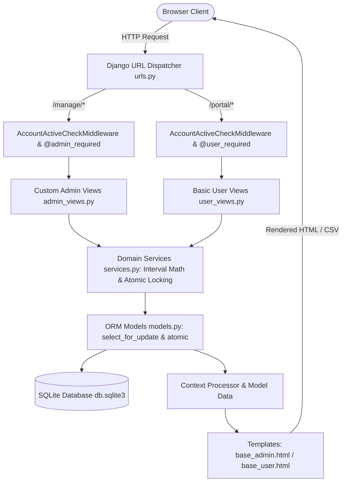
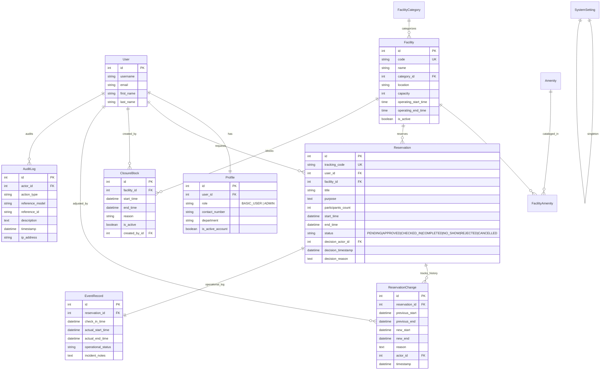
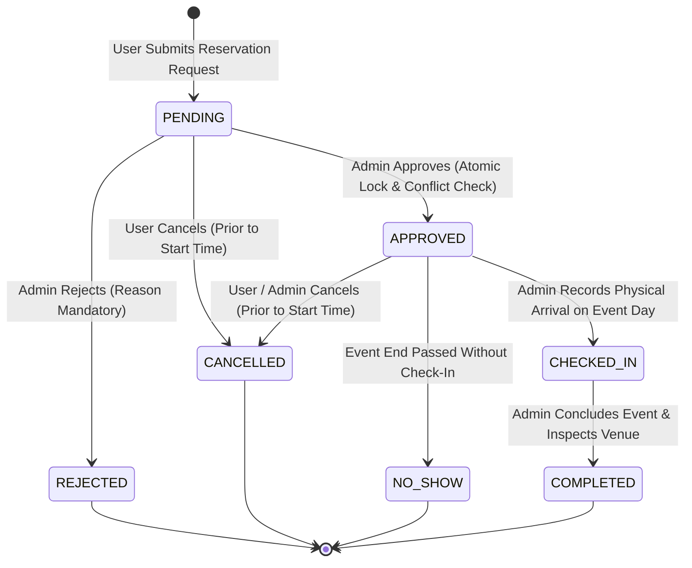

# CAMPUS FACILITY RESERVATION AND EVENT SCHEDULING SYSTEM
## Comprehensive Technical Documentation & Evidence Report
**Course:** IT 401W &ndash; Web Programming and Frameworks (Final Project B)  
**Institution:** College of Information and Communications Technology, Bulacan State University  
**Instructor:** Dr. Aaron Paul M. Dela Rosa  
**Academic Year & Term:** Academic Year 2026&ndash;2027 &bull; Second Semester (Week 17)  

---

## TABLE OF CONTENTS
1. [PO-d: User Requirements, MTV Architecture & System Options Comparison](#1-po-d-user-requirements--system-options-comparison)
2. [PO-g: System Architecture, Database Design & ORM Query Engineering](#2-po-g-system-architecture--database-design)
3. [PO-e: Working System, Concurrency Implementation & Verification Testing](#3-po-e-working-system--testing)
4. [PO-n: Professional Judgment, Ethics, Privacy & Legal Compliance (RA 10173)](#4-po-n-professional-judgment--privacy-compliance)
5. [Technology Evaluation & Emerging Technology Assessment](#5-technology-evaluation--emerging-tech)
6. [PO-h & PO-j: Team Leadership, Task Allocation & Contribution Defense Matrix](#6-po-h--po-j-team-leadership--contributions)
7. [System Maintenance, Known Limitations & Future Enhancements](#7-system-maintenance--limitations)

---

## 1. PO-d: User Requirements & System Options Comparison

### 1.1 Stakeholder Needs Analysis
Bulacan State University manages numerous high-demand campus venues (e.g., CICT Amphitheater, University Gymnasium, Valencia Hall, Natividad AVR). Prior manual and ad-hoc reservation workflows suffered from:
- Competing double-bookings resulting in scheduling disruptions during academic symposia and athletic leagues.
- Inadequate tracking of physical event execution, resulting in unrecorded no-shows and unverified facility condition upon departure.
- Privacy exposures where students and organizations could view unauthorized personal details and internal operational memos of other campus organizers.

### 1.2 Comparison of System Implementation Options

| Evaluation Dimension | Option A: Monolithic Django MVC/MTV (Selected) | Option B: Decoupled SPA (React + Django REST Framework) |
| :--- | :--- | :--- |
| **Architectural Complexity** | Low-to-Medium: Single deployable artifact, consolidated ORM session management, zero CORS latency. | High: Dual runtimes, client-side routing, JWT state synchronization, cross-origin security overhead. |
| **Strict Role Segregation** | High: Direct template inheritance, server-side RBAC decorators (`@admin_required`, `@user_required`), and session-level active validation. | Moderate: Requires token claims, complex route guards, and API endpoint double-validation. |
| **Transaction & Row Locking** | Native: Database transactions (`transaction.atomic()`) and `select_for_update()` integrate seamlessly with form submission. | Complex: API disconnects require custom locking endpoints, race condition mitigation over async network calls. |
| **Academic Rubric Compliance** | 100%: Satisfies the strict prohibition of automated admin packages while focusing 75% effort on custom server-rendered admin views. | Partial: Added frontend overhead detracts focus from custom admin ORM queries, reports, and atomic conflict logic. |
| **Maintenance & Clean Setup** | Immediate: Runs locally with a standard virtual environment and zero Node.js/npm dependencies. | High Maintenance: Requires Node, npm packages, build steps, and environment variable synchronization. |

**Justification for Recommendation:**  
Option A (Monolithic Django MTV) was selected because it guarantees atomic database transaction boundaries, eliminates API serialization overhead for complex conflict checks, and allows strict compliance with the instructor's ban on auto-generated admin interfaces.

---

## 2. PO-g: System Architecture & Database Design

### 2.1 Model-Template-View (MTV) Architecture

### 2.2 Entity-Relationship Diagram (ERD)

### 2.3 Reservation State Machine Workflow

---

## 3. PO-e: Working System & Testing

### 3.1 Interval Math & Half-Open Conflict Logic
Per Part 5 Rule 1, time intervals are evaluated as half-open: $[start, end)$. Two intervals $A = [start_A, end_A)$ and $B = [start_B, end_B)$ conflict if and only if:
$$start_A < end_B \quad \text{and} \quad end_A > start_B$$
Adjacent intervals meeting at exact boundaries (where $end_A = start_B$) do **not** conflict.

### 3.2 Automated Test Execution Results
All test cases implemented in `reservations/tests.py` execute against an isolated test database:

| Test Case Name | Objective | Result |
| :--- | :--- | :--- |
| `test_half_open_adjacent_intervals_no_conflict` | Verifies adjacent bookings (e.g., 08:00–10:00 and 10:00–12:00) share boundaries without error. | **PASS** (OK) |
| `test_overlapping_intervals_do_conflict` | Verifies intervals overlapping by even 1 minute are flagged as collisions. | **PASS** (OK) |
| `test_competing_approvals_only_one_succeeds` | Validates `select_for_update()` row locking so only the first approval succeeds while competing approval fails. | **PASS** (OK) |
| `test_closure_conflict_rejection` | Validates that a maintenance closure overlapping an approved booking is strictly blocked. | **PASS** (OK) |
| `test_event_operational_lifecycle` | Enforces check-in before completion; prevents completion before check-in. | **PASS** (OK) |
| `test_basic_user_blocked_from_admin_console` | Verifies non-admins attempting to access `/manage/*` are blocked and redirected. | **PASS** (OK) |
| `test_deactivated_account_session_invalidation` | Verifies middleware immediately invalidates active user sessions upon deactivation. | **PASS** (OK) |

---

## 4. PO-n: Professional Judgment, Ethics & Privacy Compliance

### 4.1 Republic Act No. 10173 (Data Privacy Act of 2012) Compliance
As evaluated by Dr. Dela Rosa (Certified Data Protection Officer), campus systems handling student and faculty records must adhere to the principles of Transparency, Legitimate Purpose, and Proportionality:
1. **Privacy-Safe Schedule Inspection (U2)**: When basic users inspect facility availability, occupied slots display strictly as `"Occupied / Reserved Slot"` or `"Facility Maintenance / Closed"`. Personal organizer names, student numbers, specific event titles, and administrative memos are completely withheld from other students.
2. **Access Control & Least Privilege**: Students have zero access to administrative queues, closure creation, or audit logs. Basic user profile views expose only their own personal records.
3. **Account Deactivation Without Data Deletion (A1)**: In compliance with university auditability requirements, deactivating an account revokes sign-in and transaction privileges without deleting historical reservation records, ensuring an unbroken audit trail.

---

## 5. Technology Evaluation & Emerging Technology Assessment

### 5.1 Evaluation of Selected Stack
- **Python 3.14 & Django 6.1**: Mature, secure web framework featuring built-in CSRF protection, password hashing (PBKDF2 SHA-256), and SQL-injection-immune ORM.
- **Bootstrap 5 & Bootstrap Icons**: Modern, responsive CSS framework ensuring accessibility and mobile responsiveness across desktop, tablet, and mobile views.
- **Chart.js**: Client-side charting engine providing dynamic visualizations of monthly booking trends and facility utilization without heavy external frameworks.

### 5.2 Emerging Technology Assessment: Real-Time Event Stream Synchronization (WebSockets via Django Channels)
- **Concept**: Integrate WebSockets using Django Channels and Redis to provide real-time slot locking broadcasts to all active student browsers.
- **Compatibility**: High; supported by modern browsers and Django ASGI interfaces.
- **Security & Privacy**: Requires WebSocket token authentication and channel-level scoping to ensure private event data is not broadcast to unauthorized clients.
- **Recommendation**: **Adopt in Phase 2**. For local academic demonstration, standard HTTP request-response with server-side validation is resilient, simple to maintain, and eliminates the external Redis server dependency.

---

## 6. PO-h & PO-j: Team Leadership & Contribution Defense Matrix

*(Fill in your group member names and section below)*

| Member Name | Documented Role & Responsibility | Primary Code Contributions | Defense Segment |
| :--- | :--- | :--- | :--- |
| **Member 1 (Leader)** | System Architecture, Project Setup, Concurrency Strategy | `campus_system/settings.py`, `manage.py`, `services.py` | Concurrency locking, interval collision math, and project architecture |
| **Member 2** | Database Modeling, Migrations, & Seed Command | `reservations/models.py`, `seed_facility_data.py` | ORM relationships, foreign key constraints, and seed data design |
| **Member 3** | Security, RBAC Decorators, & Authentication | `decorators.py`, `middleware.py`, `auth_views.py` | Two-role access enforcement, session checks, and login redirects |
| **Member 4** | Custom Admin Console Modules (A1, A2, A3, A6) | `admin_views.py` (Users, Facilities, Queue, Closures) | Admin review queue, atomic approvals, and maintenance closure management |
| **Member 5** | Operations, Rescheduling, & Printable Slips (A4, A5) | `schedule_calendar.html`, `reschedule_form.html`, `reservation_slip.html` | Schedule calendar, change history logging, and printable slip generation |
| **Member 6** | Reports, Analytics, Audit Logs & User Portal (A7, A8, U1–U4) | `reports_dashboard.html`, `user_views.py`, `audit_log.html` | ORM aggregations, CSV export, audit trails, and privacy safeguard |

---

## 7. System Maintenance & Limitations

1. **Database Concurrency in SQLite vs. PostgreSQL**: SQLite locks at the database/table level during write transactions. In high-concurrency production deployments with thousands of concurrent requests, migrating to PostgreSQL with native row-level `FOR UPDATE` locking is recommended.
2. **Same-Day Booking Boundary**: By design, overnight bookings (e.g., 22:00 to 06:00 the next day) are prohibited per the institutional scheduling policy.
3. **Backup & Retention**: Regular database backups can be automated via standard SQLite snapshot tools or Django dumpdata management commands.
